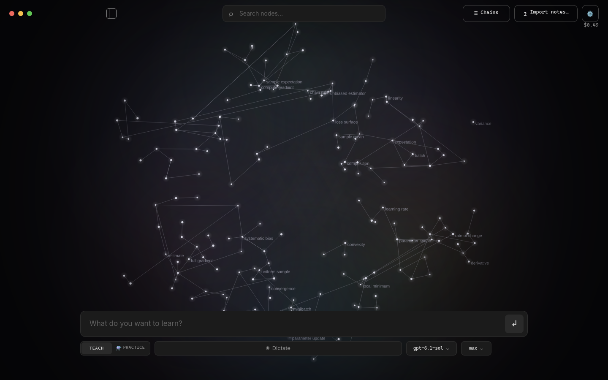
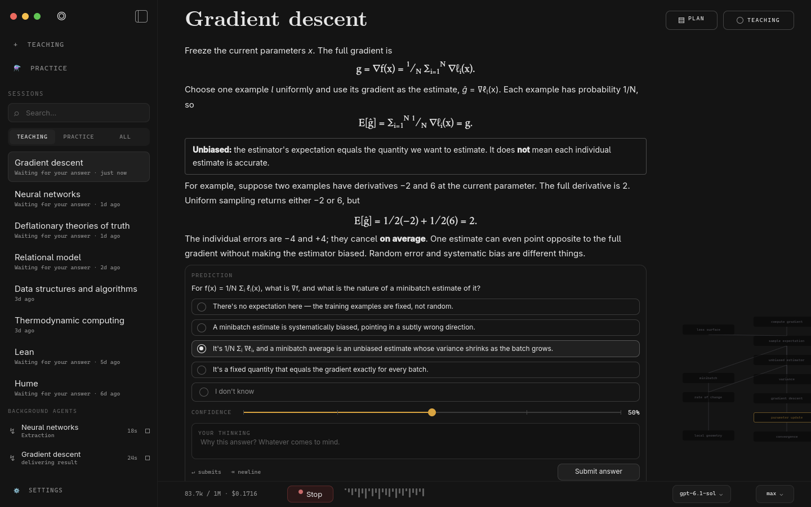

# Brainroom

A native **Rust + Qt 6** reimplementation of the LearnHarness learning harness: adaptive teaching, graded practice, and a persistent knowledge graph — without Electron.

**Status: Phase 0 (UI parity + foundation).** The Qt Quick shell now mirrors the LearnHarness home/graph and teaching-session layouts, with clickable graph nodes, pan/zoom, a session sidebar, prediction card, confidence/thinking fields, and a settings shell. Live OpenRouter streaming is wired through the Rust bridge into the session view; the full agent loop, tool calls, and persistence are next. See [`docs/FEATURES.md`](docs/FEATURES.md) for the full migration checklist and [`docs/PLAN.md`](docs/PLAN.md) for the phase plan.





## Based on and inspired by LearnHarness

Brainroom is based on and inspired by **[LearnHarness](https://github.com/amosblomqvist/learnharness)** by Amos Blomqvist, licensed **AGPL-3.0**. LearnHarness is the reference for the product behavior, teaching methodology, prompts, data formats, and architecture. Brainroom is an independent Rust/Qt implementation and is **not affiliated with or endorsed by** the LearnHarness project.

The original LearnHarness license and copyright notice are preserved in [`LICENSE`](LICENSE). See [`NOTICE.md`](NOTICE.md) for the full attribution.

## Why

The Electron + Next.js LearnHarness is excellent but its idle footprint is heavy: measured **~543 MB RSS** for the shell + server on this machine. Brainroom targets **120–250 MB idle** with a native Qt Quick UI and a Rust core, keeping browser memory only for HTML/JS demos while they are open.

## Architecture

```
app/            Qt Quick/QML application shell (cxx-qt)
crates/core     contracts, settings, grading, plan tree, coverage, chains
crates/store    chats, graph ledgers, jobs, practice, settings, auth
crates/ai       provider clients, streaming, tool calls, fallbacks, catalogs
crates/agent    prober/teacher, tools, subagents, extraction, practice, jobs
crates/platform audio, PDF, updater, packaging, single-instance
```

The main process is pure Rust. HTML/JS demos and visual verification use a lazily spawned browser child; math uses `katex-native`, diagrams use `flowmaid`, and the chat/graph UI is Qt Quick.

## Reference projects

Two existing Rust/Qt applications are used as implementation references (not vendored):

- **[Corcho](https://github.com/emiliano-go/corcho)** — MIT, Rust + Qt 6 + `cxx-qt` 0.10; a native grid workspace with AI providers, SSE streaming, QtWebEngine, git sync, updates, MCP, and AppImage/deb packaging. Primary reference for the Rust/Qt wiring and platform work.
- **[Orchard](https://github.com/SFG5453/Orchard)** — AGPL-3.0-or-later; native Qt interface with a Rust audio core over FFI. Secondary reference for C++/Qt + Rust integration, cross-platform packaging, and provider/service boundaries.

See [`docs/REFERENCES.md`](docs/REFERENCES.md) for what was learned.

## Build

Requirements: Rust 1.85+, Qt 6.8+ (`Quick`, `QuickControls2`), `cxx-qt` 0.10 build tooling.

```bash
cargo run -p brainroom
```

The current build opens the home graph and session views. Run `cargo run -p brainroom -- --home` or `--session` to choose the initial view.

## Plan

The executable plan lives in the `rbg` plan store for this repository (`brainroom-full-parity`). The readable summary is in [`docs/PLAN.md`](docs/PLAN.md). Drift audits are run with `plan_audit` after each milestone.

## License

AGPL-3.0-only, matching the upstream LearnHarness license. See [`LICENSE`](LICENSE) and [`NOTICE.md`](NOTICE.md).
